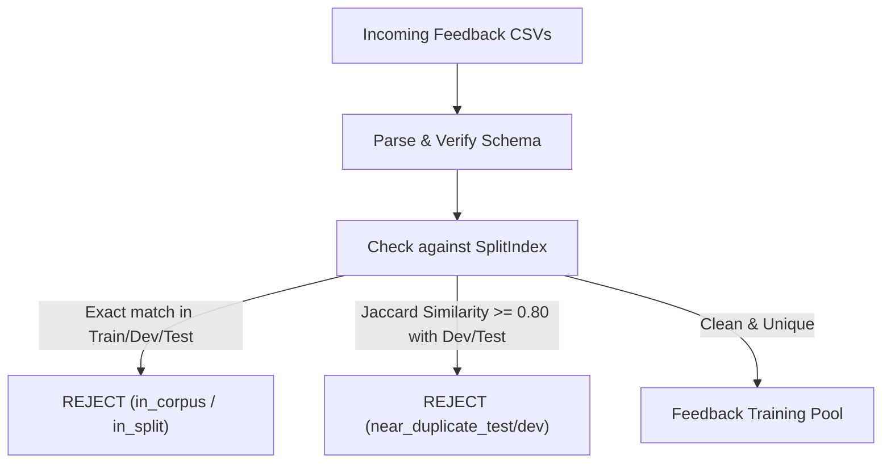

# Human-in-the-Loop (HITL) Retraining Workflow

RinTag incorporates a Human-in-the-Loop (HITL) framework allowing continuous model improvement from community corrections while enforcing strict validation and leakage prevention standards.

---

## 1. Feedback Collection Streams

RinTag supports two complementary feedback channels:

1. **Passive Library Feedback (`rintag.enable_passive_feedback()`)**:
   Runs silently in end-user applications or research pipelines. Sentences containing any token with confidence $< 0.75$ or any out-of-vocabulary (OOV) word are buffered with full sentential context.
2. **Maintainer Active Learning (`demo/hitl_showcase/hitl_feedback_demo.py`)**:
   Runs batch CRF inference over unannotated sentences from the raw corpus, ranks sentences by lowest mean token confidence (uncertainty sampling), and exports the top-$N$ most uncertain sentences for expert review.

---

## 2. Ingestion & Data Hygiene Safeguards

Before any feedback sentence is accepted into training, `scripts/06_hitl.py ingest` executes automated data hygiene checks:



- **Leakage Prevention**: Feedback sentences identical or near-duplicate ($J \ge 0.80$) to `dev.csv` or `test.csv` are immediately rejected.
- **Feedback Usage**: All accepted, trainable feedback sentences are used for retraining. Feedback labels are not treated as an evaluation set because uncorrected labels can simply be the model's own predictions.
- **Evaluation**: Model comparisons use the frozen corpus test set; the dev set is reported separately. Neither corpus split is used for retraining.
- **Audit Verification**: `python scripts/06_hitl.py audit` independently checks all ingested sentences against all splits.

---

## 3. Retraining CLI (`scripts/06_hitl.py`)

The HITL lifecycle is controlled via `scripts/06_hitl.py`:

```bash
# 1. Inspect existing versions and feedback pools
python scripts/06_hitl.py status

# 2. Ingest feedback CSVs (validates schema, rejects leakage, writes data/feedback/validated/)
python scripts/06_hitl.py ingest

# 3. Audit for leakage against train, dev, and test sets
python scripts/06_hitl.py audit

# 4. Retrain candidate model (archives candidate as next version in models/)
# Thesis-grade policy requires validator tags:
python scripts/06_hitl.py retrain --label-policy validator

# Experimental diagnostic training without validator tags:
python scripts/06_hitl.py retrain --label-policy user

# 5. Evaluate and generate paired comparison reports
python scripts/06_hitl.py evaluate --version 2
python scripts/06_hitl.py compare

# 6. Verify version reproducibility
python scripts/06_hitl.py verify --version 2

# 7. Guarded promotion to active bundled library model
python scripts/06_hitl.py promote --version 2
```

---

## 4. Label Policies

| Policy | Description | Promotion Eligibility |
|---|---|---|
| `validator` | **Thesis-grade standard.** Only sentences where language experts have verified all tokens (`validator_tag`) are admitted to training. | Eligible for promotion if test metrics improve. |
| `validator_then_user` | Prefers validator annotations; falls back to user corrections when validator tag is absent. | Marked **EXPERIMENTAL**. Promotion requires `--force`. |
| `user` | Uses user corrections where present; otherwise retains the model's tag. | Marked **EXPERIMENTAL**. Promotion requires `--force`. |

---

## 5. Version Comparison Artifacts

Each retraining run outputs paired statistical comparisons in `experiments/results/hitl/`:
- `version_comparison.csv` / `version_comparison.txt`: Accuracy, Macro $F_1$, and 95% bootstrap confidence intervals across the corpus test and dev sets.
- `per_tag_f1_test.csv`: Per-tag $F_1$ deltas between versions.
- `changes_test_v{A}_to_v{B}.csv`: Token-level regressions and improvements.
- `macro_f1_by_version.png`: Longitudinal tracking plot.
